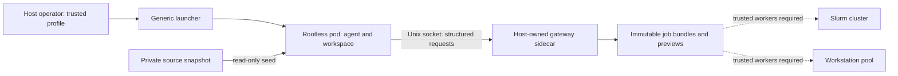

# Design

| Layer | Responsibilities | Agent access |
|---|---|---|
| Profile | Limits, image, explicit environment, backend ceilings | None |
| Image | Toolchain and pinned project dependencies | Read-only |
| Seed | Copy of selected source and inputs | Read-only |
| Workspace | Editable code, experiment outputs | Read/write, bounded tmpfs |
| Gateway socket | Structured preparation and status requests | Connect only; mount read-only |
| Gateway sidecar | Separate PID/mount namespace, immutable policy, 128 MiB RAM and 32 processes | Socket protocol only |
| Job store | Immutable uploads, hashes, previews | Status response only |
| Host | SSH keys, VPN, original repositories, lifecycle | None |

Each task gets its own name, user namespace, network namespace, container PID
namespace, private workspace and gateway. The pod and agent container both carry
memory limits; the agent container also carries the process limit. Swap is zero.
CPU uses delegated quotas when available. Otherwise a private host-owned crun shim uses an OCI prestart hook to pin init
and `execCPUAffinity` to pin later commands. The controller checks both before
reporting a successful start. It removes `sched_setaffinity` from the default seccomp allowlist, so
agent processes cannot expand their affinity. The live probe verifies
the actual CPU IDs and denied affinity mutation. No global host service is changed.
Default seccomp remains enabled, all Linux capabilities are dropped and
no-new-privileges blocks setuid escalation. SELinux labels apply to private copies
and the gateway socket directory, never to the original project.

The preparation gateway runs as a separate non-root container in the pod, with
its own PID and mount namespaces. Sharing the pod's SELinux category lets the
Unix socket work without disabling SELinux. Its job store and profile mounts are
absent from the agent container. Both containers use offline networking. A future
live submission dispatcher belongs outside the pod and must use restricted workers.

Writable tmpfs capacities bound disk growth and also count toward the memory
limit. The gateway admits at most eight 16 MiB job bundles by default. It has no
network or execution operation in its public protocol. Uploaded files use flat
safe names, never host paths; source symlinks are rejected.

The prototype uses offline networking because a bridge or an HTTP proxy setting
alone does not stop access to private cluster endpoints. An internet-enabled
version requires an external enforcing egress gateway, including DNS/IP and IPv6
policy. Changing `network` to `host` is rejected.

Lifecycle: build image -> privately stage inputs -> start -> execute tools ->
prepare bundles -> export results -> stop. Image building is trusted host work
and can access package registries. The runtime pod cannot.

Acceptance for live submission: implement the worker contract for each actual
cluster, validate destination mounts/identity/network/resource limits, preserve
canonical workload rendering and checkpoint preflight, then explicitly enable
the approved adapter. Source approval is separate from permitting host access.

Startup also validates explicit permissions and generates pod-constitution.md,
AGENTS.md, CLAUDE.md and a non-secret pod-settings.json in the copied seed before
launch. Project root instructions are retained beneath the generated pointers.
The runtime copies these files into the workspace automatically. Writable
instruction/settings copies do not affect enforcement.

The gateway reads the same immutable effective profile as the launcher. In none
mode it returns an empty backend list and rejects preparation/status requests.
In prepare mode it enforces the configured backends and bundle/resource ceilings.
Submit mode is rejected during profile validation because this release has no
verified destination workers. No pod or gateway is launched for that request.
